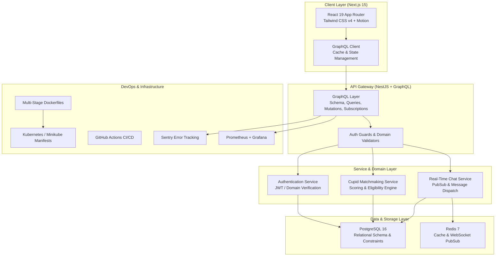

# 💌 MATCH@SAHRDAYA

<div align="center">


**A campus-exclusive, Valentine-themed social discovery and matchmaking web platform designed specifically for students of Sahrdaya College of Engineering & Technology.**

[Explore Architecture](docs/ARCHITECTURE.md) • [Project Roadmap](docs/PROJECT_PLAN.md) • [GraphQL API Spec](docs/GRAPHQL_API_SPEC.md) • [Database Schema](docs/DATABASE_SCHEMA.md) • [Docker & K8s Guide](docs/DOCKER_K8S_GUIDE.md)

</div>

---

## 📖 Overview

**MATCH@SAHRDAYA** addresses the common disconnect between academic departments and college years by providing a fun, season-bounded social matching experience during Valentine's week.

Built as an academic project for the **Web Technologies** curriculum, the platform couples an engaging, highly responsive frontend with an enterprise-grade backend following industry best practices.

### 🌟 Key Highlights
- **Campus-Only Trust Network:** College email identity domain restriction (`@sahrdaya.ac.in`).
- **Dual Matchmaking Engines:**
  - 🏹 **Cupid Match (Interest Compatibility):** Multi-attribute weighted algorithm scoring shared hobbies, intents, and college year.
  - 🎲 **Serendipity Match (Random):** Discover unexpected connections across campus branches.
- **10-Second Suspense Screen:** Interactive countdown and animated reveal highlighting curated Valentine campus picks.
- **Real-Time Direct Messaging:** Live chat between mutually matched students with unread badges and responsive conversation threads.
- **Safety First:** Built-in one-click blocking, abuse reporting, and moderation controls.
- **Mobile-First Luxury Aesthetic:** Bespoke velvet, rose, and gold visual palette with smooth Framer Motion interactions.

---

## 🏛️ System Architecture



---

## 🛠️ Technology Stack Matrix

| Area | Technology | Purpose |
|---|---|---|
| **Frontend Framework** | [Next.js 15](https://nextjs.org/) (App Router) | Server-Side Rendering, Static Optimization, Client State |
| **UI Library** | [React 19](https://react.dev/) | Modern reactive component architecture |
| **Styling** | [Tailwind CSS v4](https://tailwindcss.com/) | Atomic responsive design with customized theme tokens |
| **Animations** | [Motion](https://motion.dev/) (Framer Motion) & Canvas Confetti | Celebration effects, page transitions, interactive cards |
| **Icons** | [Lucide React](https://lucide.dev/) | Clean, consistent vector icon set |
| **Backend Framework** | [NestJS v10+](https://nestjs.com/) | Enterprise modular architecture with TypeScript |
| **API Protocol** | [GraphQL](https://graphql.org/) (Apollo Server) | Typed queries, mutations, subscriptions, zero overfetching |
| **Database** | [PostgreSQL 16](https://www.postgresql.org/) | ACID relational data integrity and foreign key constraints |
| **ORM / Data Access** | [Prisma](https://www.prisma.io/) / TypeORM | Type-safe queries, migrations, and automated relations |
| **Containerization** | [Docker](https://www.docker.com/) | Multi-stage production container builds |
| **Orchestration** | [Kubernetes](https://kubernetes.io/) / Minikube | Pod management, ClusterIP services, ingress routing |
| **CI/CD** | [GitHub Actions](https://github.com/features/actions) | Automated linting, type-checking, tests, container validation |
| **Observability** | [Sentry](https://sentry.io/) & [Prometheus](https://prometheus.io/) | Real-time crash diagnostics and performance metrics |

---

## 📁 Project Structure

```
Web-PBL/
├── app/                        # Next.js App Router (Layouts, Pages, Global Styles)
│   ├── globals.css             # Romantic color tokens and animations
│   ├── layout.tsx              # Root HTML layout with Playfair & Jakarta typography
│   └── page.tsx                # Client application hub & view router
├── components/                 # Modular React Presentation Components
│   ├── ChatView.tsx            # Messaging thread and conversation directory
│   ├── DashboardView.tsx       # Profile snapshot, match statistics, active matches
│   ├── LandingView.tsx         # Valentine hero section with call-to-action
│   ├── LoginModal.tsx          # College email authentication dialog
│   ├── MatchingScreen.tsx      # 10-second animated matchmaking sequence
│   ├── MatchResultModal.tsx    # Confetti celebration & match breakdown modal
│   ├── Navbar.tsx              # Navigation bar with user switcher & indicators
│   ├── OnboardingView.tsx      # Multi-step profile setup wizard
│   ├── SafetyModals.tsx        # Block & report dialogs
│   ├── SettingsModal.tsx       # Profile editor & preferences
│   ├── Toast.tsx               # Non-intrusive alert notification system
│   ├── react-bits/             # Specialized text and visual micro-effects
│   └── ui/                     # Shared UI components (Cupid emblem, buttons)
├── docs/                       # Comprehensive Architecture & Engineering Specs
│   ├── ARCHITECTURE.md         # Full-stack system architecture & design
│   ├── PROJECT_PLAN.md         # Phased academic milestones & roadmap
│   ├── GRAPHQL_API_SPEC.md     # Complete GraphQL SDL schema, queries & mutations
│   ├── DATABASE_SCHEMA.md      # PostgreSQL relational tables, ERD, and Prisma models
│   ├── DOCKER_K8S_GUIDE.md     # Multi-stage Dockerfiles & Kubernetes manifests
│   ├── MONITORING_CICD.md      # GitHub Actions CI workflow & Sentry/Prometheus
│   └── DEVELOPMENT.md          # Local developer setup and execution commands
├── hooks/                      # Custom React Hooks (mobile detection, layout)
├── lib/                        # Utilities, algorithms, and local stores
│   ├── confetti.ts             # Canvas confetti animation wrapper
│   ├── mock-data.ts            # Sahrdaya student profiles, interests, campus picks
│   ├── storage.ts              # LocalStorage persistence & matchmaking scoring logic
│   └── utils.ts                # Tailwind class merge helper (clsx + twMerge)
├── types/                      # TypeScript domain model definitions
│   └── match.ts                # User, Match, Message, Conversation, Interest types
├── .env.example                # Multi-tier environment variable template
├── .gitignore                  # Comprehensive ignore rules (excluding secrets & agent files)
├── eslint.config.mjs           # ESLint 9 modern flat configuration
├── next.config.ts              # Next.js standalone optimization & remote image domains
├── package.json                # Project dependencies, scripts, and metadata
└── tsconfig.json               # Strict TypeScript configuration
```

---

## 🚀 Getting Started

### Prerequisites
- Node.js `20.x` or later
- npm or bun

### Local Installation
```bash
# 1. Clone the repository
git clone https://github.com/<your-username>/Web-PBL.git
cd Web-PBL

# 2. Copy the environment variables template
cp .env.example .env.local

# 3. Install dependencies
npm install

# 4. Start local development server
npm run dev
```

Open [http://localhost:3000](http://localhost:3000) in your browser.

---

## 📚 Engineering Documentation Index

Detailed specifications and guides are located in the [`docs/`](docs/) directory:

| Document | Description |
|---|---|
| [**Architecture Guide**](docs/ARCHITECTURE.md) | High-level topology, module separation, frontend & backend design |
| [**Project Roadmap**](docs/PROJECT_PLAN.md) | Phased milestones mapped to the 6 academic project evaluation phases |
| [**GraphQL API Specification**](docs/GRAPHQL_API_SPEC.md) | Complete SDL schema, types, queries, mutations, subscriptions |
| [**Database Schema**](docs/DATABASE_SCHEMA.md) | PostgreSQL ERD, table definitions, constraints, and Prisma schema |
| [**Docker & Kubernetes Guide**](docs/DOCKER_K8S_GUIDE.md) | Dockerfiles, Docker Compose, and Kubernetes (Minikube) deployment |
| [**CI/CD & Monitoring Guide**](docs/MONITORING_CICD.md) | GitHub Actions pipeline, Sentry error tracking, Prometheus metrics |
| [**Development Guide**](docs/DEVELOPMENT.md) | Local development setup, npm scripts, and contribution guidelines |

---

## ⚖️ SKILL.md Engineering Principles & Quality Bar

This repository adheres strictly to the operational instructions and standards defined in `SKILL.md`:

- **Clear Architectural Boundaries:** Next.js (presentation/interaction) ➔ NestJS (business rules/validation/auth) ➔ GraphQL (typed operations) ➔ PostgreSQL (persistence).
- **Functioning Controls:** Every visible button, modal, form input, and toggle must perform its intended end-to-end action across responsive viewports.
- **Real Backend Persistence:** Implemented workflows must be backed by live GraphQL operations and database transactions; mock results are never passed off as completed backend logic.
- **Server-Side Security:** Authorization and email domain restrictions (`@sahrdaya.ac.in`) are strictly validated on the server.
- **Definition of Done:** A milestone is only complete when integration across UI ➔ GraphQL ➔ NestJS ➔ Database is verified with passing builds and documented status.

---

## 📊 Academic Assessment Alignment

This project is developed in accordance with the **Web Technologies Project Guidelines**:

| Phase | Milestone | Assessment | Status |
|---|---|---|---|
| **Phase 1** | Preliminary Design & Technology Stack | — | ✅ Complete |
| **Phase 2** | Zeroth Presentation & Architecture Specs | — | ✅ Complete |
| **Phase 3** | Core Application & Initial Integration | **Evaluation 1 (10 Marks)** | 📋 Planned |
| **Phase 4** | Real-Time Features & Containerization | — | 📋 Planned |
| **Phase 5** | Kubernetes, CI/CD, Monitoring & Report | **Project Report (5 Marks)** | 📋 Planned |
| **Phase 6** | Final Evaluation, Presentation & Live Demo | **Evaluation 2 (10 Marks)** | 📋 Planned |

---

## 🛡️ License & Acknowledgments

- **Institution:** Department of Computer Science & Engineering, Sahrdaya College of Engineering & Technology.
- **Course:** Web Technologies Project Component (Academic Year 2026).
- **License:** Distributed under the MIT License for educational and non-commercial academic demonstration.
