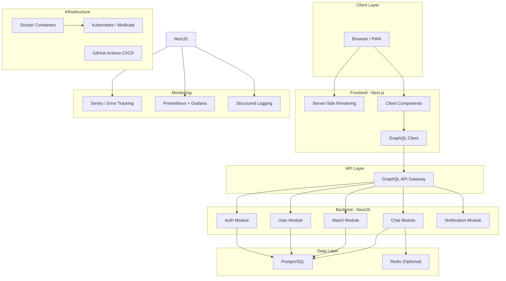
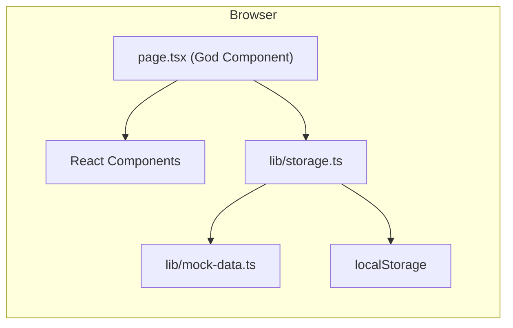
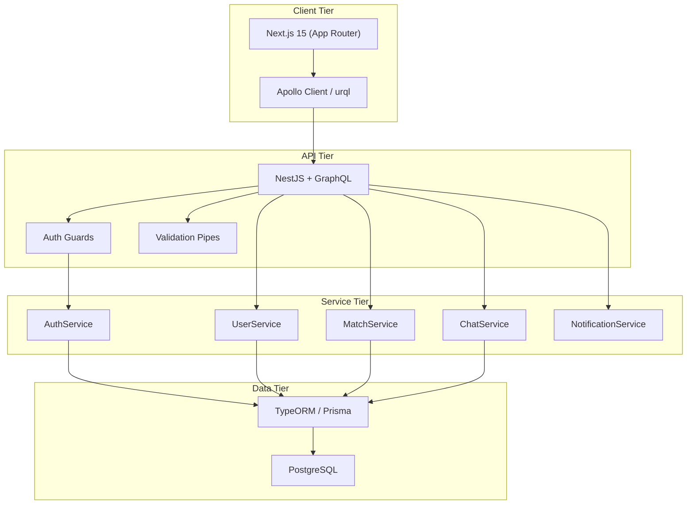
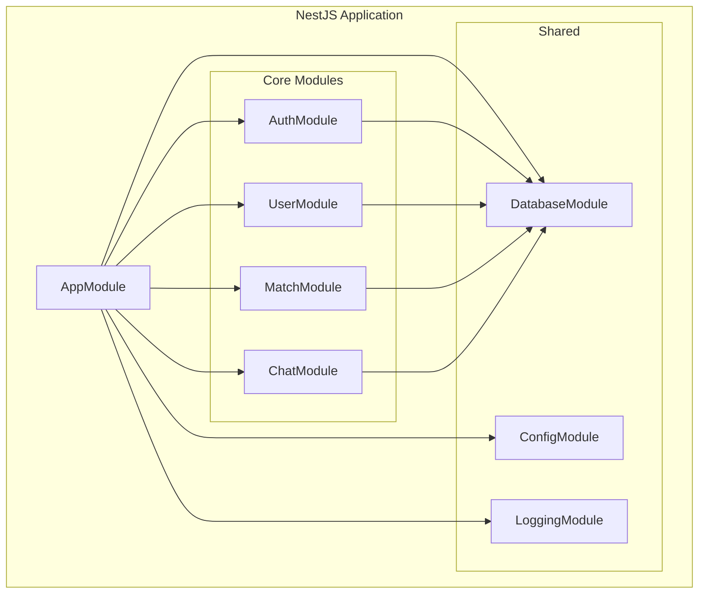
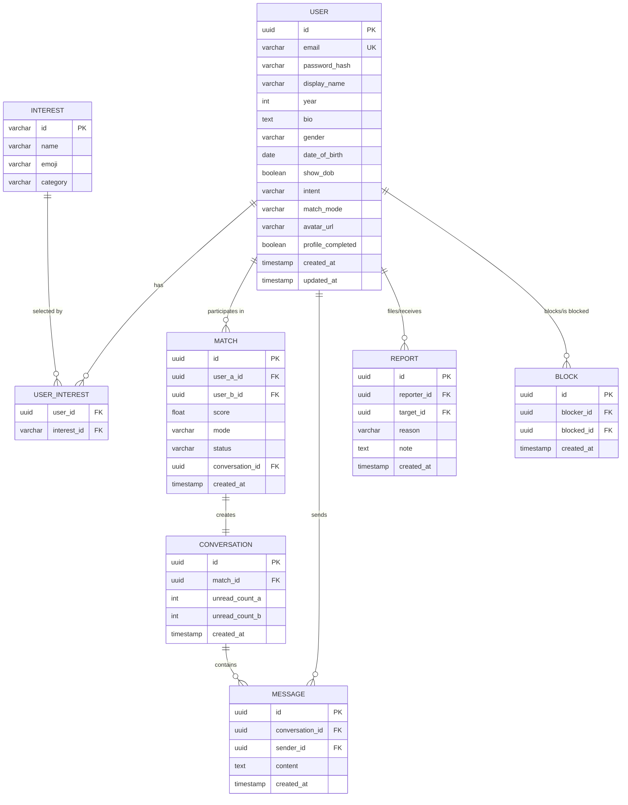
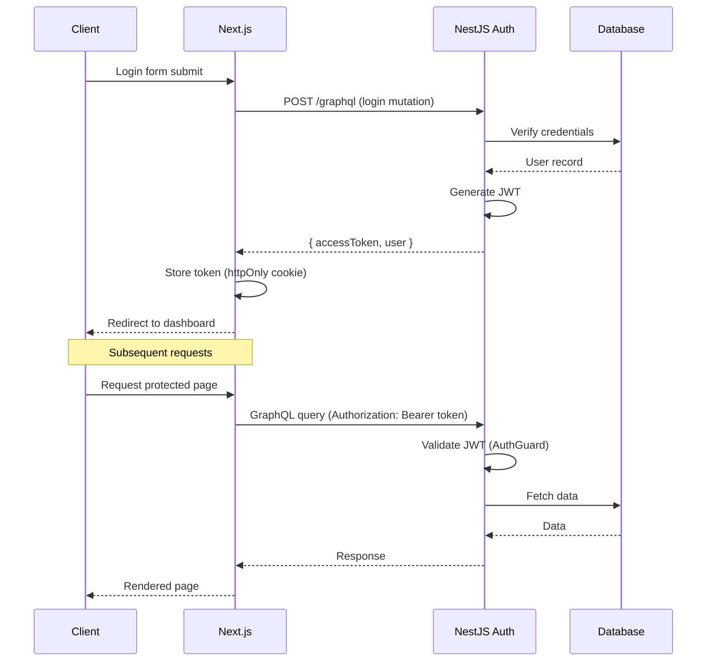
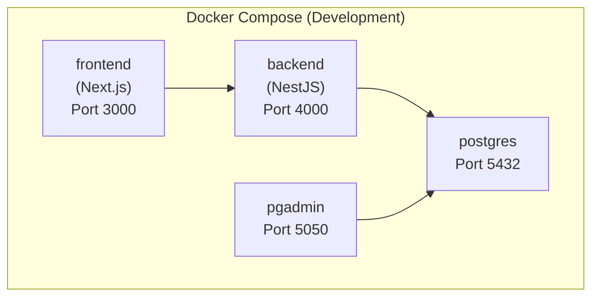
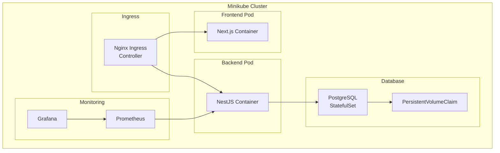

# System Architecture — MATCH@SAHRDAYA

> This document describes the full system architecture for the MATCH@SAHRDAYA platform, covering both the current frontend prototype and the planned full-stack implementation.

---

## Table of Contents

- [1. High-Level Overview](#1-high-level-overview)
- [2. Current Architecture (Frontend Prototype)](#2-current-architecture-frontend-prototype)
- [3. Target Architecture (Full Stack)](#3-target-architecture-full-stack)
- [4. Frontend Architecture](#4-frontend-architecture)
- [5. Backend Architecture](#5-backend-architecture)
- [6. GraphQL API Layer](#6-graphql-api-layer)
- [7. Database Layer](#7-database-layer)
- [8. Authentication & Authorization](#8-authentication--authorization)
- [9. Infrastructure & Deployment](#9-infrastructure--deployment)
- [10. Monitoring & Observability](#10-monitoring--observability)

---

## 1. High-Level Overview

MATCH@SAHRDAYA is a campus-only social matching platform built for Sahrdaya College of Engineering & Technology. The system matches students based on shared interests and enables real-time communication between matched pairs.



---

## 2. Current Architecture (Frontend Prototype)

The current implementation is a **single-page application** exported from Google AI Studio. All logic runs client-side with localStorage for persistence.



### Current Limitations

| Area | Limitation |
|------|-----------|
| **State Management** | Single god component (`page.tsx`) holds all state — ~460 lines |
| **Data Persistence** | localStorage only — no server, no database |
| **Authentication** | Email-only, no password, no token verification |
| **Matchmaking** | Client-side algorithm — easy to manipulate |
| **Chat** | Simulated auto-replies with `setTimeout` — not real-time |
| **Multi-user** | "Switch user" feature for testing, not real sessions |
| **Routing** | State-based view switching, not URL-based routing |

---

## 3. Target Architecture (Full Stack)



---

## 4. Frontend Architecture

### Directory Structure (Planned)

```
app/
├── (auth)/
│   ├── login/page.tsx
│   └── register/page.tsx
├── (main)/
│   ├── dashboard/page.tsx
│   ├── chat/
│   │   ├── page.tsx
│   │   └── [conversationId]/page.tsx
│   ├── match/page.tsx
│   ├── profile/page.tsx
│   └── settings/page.tsx
├── layout.tsx
├── page.tsx              # Landing page
└── globals.css

components/
├── features/
│   ├── auth/             # Login, Register components
│   ├── chat/             # Chat UI components
│   ├── dashboard/        # Dashboard widgets
│   ├── matching/         # Matching flow components
│   ├── onboarding/       # Profile setup wizard
│   └── profile/          # Profile display/edit
├── layout/
│   ├── Navbar.tsx
│   ├── Footer.tsx
│   └── Sidebar.tsx
├── shared/
│   ├── Toast.tsx
│   ├── Modal.tsx
│   └── LoadingSpinner.tsx
└── ui/
    ├── Button.tsx
    ├── Input.tsx
    ├── Card.tsx
    └── CupidEmblem.tsx
```

### State Management Strategy

| Concern | Solution |
|---------|----------|
| Server state (users, matches, messages) | Apollo Client cache / React Query |
| Auth state | React Context + JWT token |
| UI state (modals, toasts) | React `useState` / Zustand |
| Form state | React Hook Form |
| URL state | Next.js App Router |

### Routing Plan

| Route | Component | Auth Required |
|-------|-----------|:---:|
| `/` | Landing page | ❌ |
| `/login` | Login form | ❌ |
| `/register` | Registration | ❌ |
| `/onboarding` | Profile setup wizard | ✅ |
| `/dashboard` | Main dashboard | ✅ |
| `/match` | Matching screen | ✅ |
| `/chat` | Conversation list | ✅ |
| `/chat/[id]` | Chat thread | ✅ |
| `/profile` | User profile | ✅ |
| `/settings` | Settings | ✅ |

---

## 5. Backend Architecture

### NestJS Module Structure



### Module Responsibilities

| Module | Responsibility |
|--------|---------------|
| **AuthModule** | JWT auth, login/register, guards, password hashing |
| **UserModule** | Profile CRUD, interest management, avatar uploads |
| **MatchModule** | Matchmaking algorithm, match history, block/report |
| **ChatModule** | Message CRUD, conversation management, typing indicators |
| **DatabaseModule** | TypeORM/Prisma connection, migrations |
| **ConfigModule** | Environment variable validation and access |
| **LoggingModule** | Structured logging, request tracking |

---

## 6. GraphQL API Layer

### Schema Overview

See [`docs/API.md`](./API.md) for the complete GraphQL schema specification.

```graphql
# Key Types
type User { ... }
type Match { ... }
type Conversation { ... }
type Message { ... }

# Key Operations
type Query {
  me: User!
  myMatches: [Match!]!
  myConversations: [Conversation!]!
  messages(conversationId: ID!): [Message!]!
}

type Mutation {
  login(input: LoginInput!): AuthPayload!
  register(input: RegisterInput!): AuthPayload!
  updateProfile(input: UpdateProfileInput!): User!
  findMatch: Match
  sendMessage(input: SendMessageInput!): Message!
  blockUser(userId: ID!): Boolean!
  reportUser(input: ReportInput!): Boolean!
}
```

---

## 7. Database Layer

See [`docs/DATABASE.md`](./DATABASE.md) for the complete schema design.

### Entity Relationship Diagram



---

## 8. Authentication & Authorization

### Auth Flow



### Security Measures

- **Password hashing:** bcrypt with salt rounds
- **JWT tokens:** Short-lived access tokens (15min), refresh tokens (7d)
- **CORS:** Restricted to frontend origin
- **Rate limiting:** Login attempts throttled
- **Input validation:** class-validator on all DTOs
- **SQL injection:** Parameterized queries via ORM
- **XSS:** React's built-in escaping + CSP headers

---

## 9. Infrastructure & Deployment

### Docker Architecture



### Kubernetes Architecture



See [`docs/DEPLOYMENT.md`](./DEPLOYMENT.md) for detailed deployment instructions.

---

## 10. Monitoring & Observability

| Layer | Tool | Purpose |
|-------|------|---------|
| Error tracking | Sentry | Capture and alert on runtime errors |
| Metrics | Prometheus | Collect application and system metrics |
| Dashboards | Grafana | Visualize metrics and set up alerts |
| Logging | Winston/Pino | Structured JSON logging |
| Health checks | NestJS Terminus | `/health` endpoint for K8s probes |

### Key Metrics to Track

- Request latency (p50, p95, p99)
- Error rate by endpoint
- Active users count
- Match success rate
- Message throughput
- Database connection pool usage
- Memory and CPU utilization
