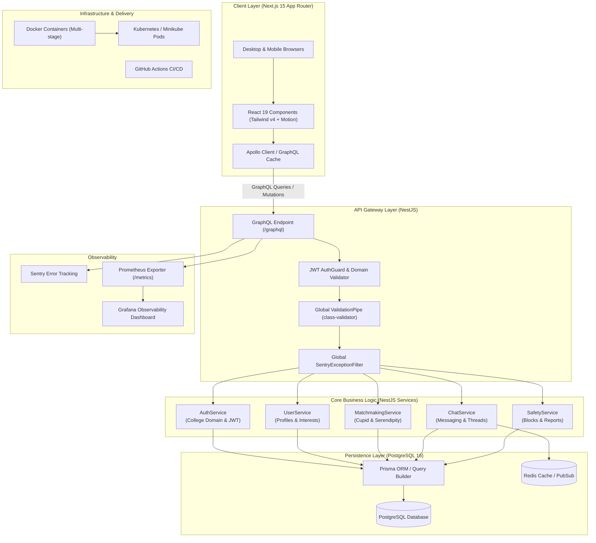
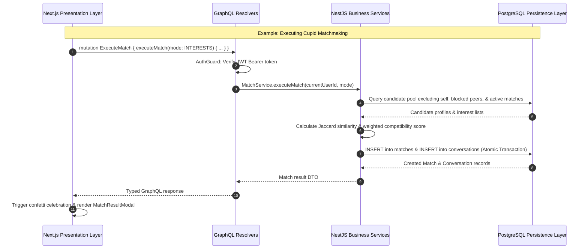

# System Architecture — MATCH@SAHRDAYA

> **Source of Truth:** Defined in accordance with `SKILL.md` engineering rules, architectural boundaries, and the Web Technologies Project Guidelines.

---

## Table of Contents

- [1. Architectural Principles & SKILL.md Mandates](#1-architectural-principles--skillmd-mandates)
- [2. High-Level System Overview](#2-high-level-system-overview)
- [3. Current Prototype vs Target Full-Stack Architecture](#3-current-prototype-vs-target-full-stack-architecture)
- [4. Architectural Boundaries & Responsibility Separation](#4-architectural-boundaries--responsibility-separation)
- [5. Frontend Architecture (Next.js 15)](#5-frontend-architecture-nextjs-15)
- [6. Backend Architecture (NestJS)](#6-backend-architecture-nestjs)
- [7. GraphQL API Gateway](#7-graphql-api-gateway)
- [8. Persistence & Data Access (PostgreSQL & Prisma)](#8-persistence--data-access-postgresql--prisma)
- [9. Authentication & Server-Side Authorization](#9-authentication--server-side-authorization)
- [10. Containerization & Orchestration (Docker & Minikube)](#10-containerization--orchestration-docker--minikube)
- [11. Observability, Logging & Error Tracking](#11-observability-logging--error-tracking)

---

## 1. Architectural Principles & SKILL.md Mandates

Per the engineering rules defined in `SKILL.md`, the architecture adheres to four non-negotiable tenets:

1. **Strict Architectural Boundaries:**
   - **Next.js** handles presentation, responsive UI, routing, and user interaction.
   - **NestJS** owns all business rules, input validation, authentication/authorization, and persistence orchestration.
   - **GraphQL** exposes strongly-typed operations (queries, mutations, subscriptions).
   - **Database Access** remains strictly behind backend services and data-access code; the frontend never interacts directly with the database.
2. **Every Visible Control Must Function:**
   - Every visible button, modal, form input, and toggle must perform its intended end-to-end action.
   - The UI must implement explicit loading skeletons, empty states, success states, validation errors, and network failure states.
3. **Real API-Backed Data (No Fake Mock Claims):**
   - Implemented workflows must be backed by live GraphQL operations and database persistence.
   - Seed data (such as demo campus profiles) must be clearly labeled as such in database seeders; client-side mocks must not masquerade as completed backend functionality.
4. **Server-Side Security Enforcement:**
   - Hiding UI controls or buttons does not constitute authorization. All security permissions, token verifications, and resource access checks must be strictly enforced on the server.

---

## 2. High-Level System Overview



---

## 3. Current Prototype vs Target Full-Stack Architecture

### 3.1 Prototype State (As Exported from Google AI Studio)
The exported prototype is a standalone client-side Next.js application:
- **State:** Managed entirely inside a single god component (`app/page.tsx`, ~460 lines).
- **Persistence:** LocalStorage keys (`match_sahrdaya_*`) storing JSON blobs.
- **Matchmaking:** Client-side JavaScript iteration over hardcoded mock data (`lib/mock-data.ts`).
- **Chat:** Client-side `setTimeout` simulating replies from matched demo candidates.
- **Security:** No authentication token, no password hashing, client-only route branching.

### 3.2 Target Full-Stack Architecture (SKILL.md Compliance)
- **Frontend:** Modular Next.js 15 client querying GraphQL via Apollo Client, handling presentation, form validation, and reactive UI states.
- **Backend:** NestJS monolithic server structured into cohesive modules (`AuthModule`, `UserModule`, `MatchModule`, `ChatModule`, `SafetyModule`).
- **Data:** PostgreSQL 16 relational database with strict constraints (FKs, unique pairs, cascades) accessed exclusively via Prisma ORM.
- **Live Events:** GraphQL Subscriptions over WebSockets for live chat messages, typing indicators, and instant match celebration notifications.

---

## 4. Architectural Boundaries & Responsibility Separation



---

## 5. Frontend Architecture (Next.js 15)

### 5.1 Component Structure & State Separation
To eliminate the `app/page.tsx` god-component anti-pattern, components are organized by domain feature:

```
app/
├── layout.tsx                  # Root layout with fonts & theme tokens
├── page.tsx                    # Landing page view
├── dashboard/page.tsx          # Authenticated dashboard (matches, stats, quick action)
├── matching/page.tsx           # 10-second animated matchmaking suspense screen
├── chat/
│   ├── page.tsx                # Conversations directory
│   └── [id]/page.tsx           # Active message thread
└── onboarding/page.tsx         # Multi-step profile configuration wizard

components/
├── features/
│   ├── auth/LoginModal.tsx
│   ├── onboarding/OnboardingWizard.tsx
│   ├── dashboard/DashboardOverview.tsx
│   ├── matching/MatchingScreen.tsx
│   ├── matching/MatchResultModal.tsx
│   ├── chat/ChatView.tsx
│   ├── chat/MessageThread.tsx
│   └── safety/SafetyModals.tsx
├── layout/
│   ├── Navbar.tsx
│   └── Footer.tsx
└── ui/
    ├── CupidEmblem.tsx
    ├── Toast.tsx
    └── ShinyText.tsx
```

---

## 6. Backend Architecture (NestJS)

### 6.1 Module Organization
NestJS encapsulates functionality into self-contained modules following Dependency Injection:

```
backend/src/
├── app.module.ts               # Root module importing feature & core modules
├── main.ts                     # Bootstrap entrypoint (port 4000, CORS, Swagger/GQL)
├── core/
│   ├── config/                 # Environment validation via Joi / Nest Config
│   ├── database/               # PrismaClientModule & database lifecycle
│   ├── guards/                 # JwtAuthGuard, DomainVerificationGuard
│   ├── filters/                # Global SentryExceptionFilter
│   └── interceptors/           # LoggingInterceptor (request duration & tracing)
└── modules/
    ├── auth/                   # Login, college domain validation, JWT minting
    ├── user/                   # Profile CRUD, interests registry, avatar handling
    ├── match/                  # Cupid matching algorithm & serendipity engine
    ├── chat/                   # Conversation threads, message pagination, subscriptions
    └── safety/                 # Blocklist registry & conduct reporting
```

### 6.2 Thin Resolvers & Rich Services
Resolvers strictly extract incoming DTOs and user context, passing execution to business services:

```typescript
@Resolver(() => Match)
export class MatchResolver {
  constructor(private readonly matchService: MatchService) {}

  @UseGuards(JwtAuthGuard)
  @Mutation(() => Match)
  async executeMatch(
    @CurrentUser() user: AuthenticatedUser,
    @Args('mode', { nullable: true }) mode?: MatchMode,
  ): Promise<Match> {
    return this.matchService.executeMatch(user.id, mode);
  }
}
```

---

## 7. GraphQL API Gateway

- **Schema Approach:** Code-First with `@nestjs/graphql` and `@nestjs/apollo`.
- **Validation:** Server-side input validation on every mutation argument via `ValidationPipe` with `transform: true` and `whitelist: true`.
- **Data Protection:** Sanitization of database error messages to prevent internal stack traces from leaking to client responses.

---

## 8. Persistence & Data Access (PostgreSQL & Prisma)

- **PostgreSQL 16:** Enforces relational integrity, foreign key constraints (`ON DELETE CASCADE`), and custom PostgreSQL `ENUM` types.
- **Indexes:**
  - Compound indexes on `(user_a_id, user_b_id)` for duplicate match prevention.
  - Sorted chronological index on `(conversation_id, created_at DESC)` for sub-millisecond chat loading.
- **Transactions:** Atomic transactions (`prisma.$transaction`) ensure a match record and its associated conversation are committed simultaneously.

---

## 9. Authentication & Server-Side Authorization

- **Domain Restriction:** College emails must match the regular expression `^[a-zA-Z0-9._%+-]+@sahrdaya\.ac\.in$`.
- **JWT Authorization:**
  - Access tokens (expires in 15m) passed in `Authorization: Bearer <token>`.
  - Refresh tokens (expires in 7d) stored securely in HttpOnly cookies.
- **Resource Ownership Verification:** A user can only fetch conversations and send messages in threads where their `user_id` matches one of the two registered participants.

---

## 10. Containerization & Orchestration (Docker & Minikube)

- **Multi-Stage Builds:** Next.js `standalone` mode compiles minimal runtime artifacts without `node_modules` overhead.
- **Docker Compose:** Spans Frontend (3000), Backend (4000), PostgreSQL (5432), and Redis (6379) with healthcheck dependencies.
- **Kubernetes (Minikube):**
  - Declarative manifests for pods, services, ingress, and persistent volumes.
  - Configured with `readinessProbe` and `livenessProbe` to satisfy SKILL.md delivery guidelines.

---

## 11. Observability, Logging & Error Tracking

- **Sentry Integration:** Captures unhandled client errors, hydration failures, and 5xx backend server exceptions.
- **Prometheus Metrics:** Exposes system and domain metrics on `/metrics` (request duration histograms, total matches created, active chat sockets).
- **Structured JSON Logging:** Winston logger outputting timestamped, level-tagged JSON without logging credentials or private student data.
