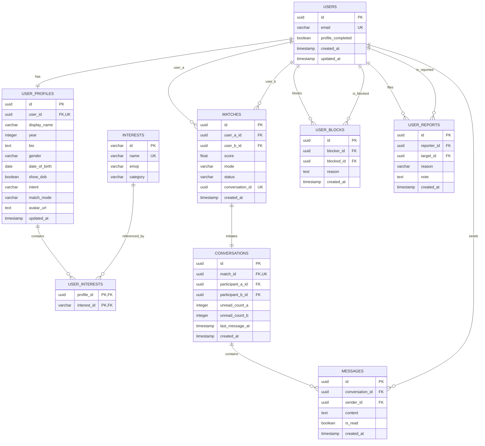

# MATCH@SAHRDAYA — Relational Database Schema Specification

> **Engine:** PostgreSQL 16+  
> **ORM Layer:** Prisma ORM / TypeORM (PostgreSQL Driver: `pg`)  
> **Naming Convention:** `snake_case` for database tables and columns  

---

## 1. Entity Relationship Diagram (ERD)



---

## 2. Table Definitions & Constraints

### 2.1 `users`
Core identity table representing registered student accounts.
```sql
CREATE TABLE users (
    id UUID PRIMARY KEY DEFAULT gen_random_uuid(),
    email VARCHAR(255) NOT NULL UNIQUE,
    profile_completed BOOLEAN NOT NULL DEFAULT FALSE,
    created_at TIMESTAMP WITH TIME ZONE NOT NULL DEFAULT CURRENT_TIMESTAMP,
    updated_at TIMESTAMP WITH TIME ZONE NOT NULL DEFAULT CURRENT_TIMESTAMP,
    CONSTRAINT check_sahrdaya_domain CHECK (email ILIKE '%@sahrdaya.ac.in')
);

CREATE INDEX idx_users_email ON users(email);
```

### 2.2 `user_profiles`
Detailed profile attributes for matchmaking and presentation.
```sql
CREATE TYPE gender_enum AS ENUM ('MAN', 'WOMAN', 'NON_BINARY', 'PREFER_NOT_TO_SAY');
CREATE TYPE intent_enum AS ENUM ('DATING', 'FRIENDSHIP', 'PARTNER', 'LIKE_MINDED_FRIEND', 'JUST_CHAT');
CREATE TYPE match_mode_enum AS ENUM ('INTERESTS', 'RANDOM');

CREATE TABLE user_profiles (
    id UUID PRIMARY KEY DEFAULT gen_random_uuid(),
    user_id UUID NOT NULL UNIQUE REFERENCES users(id) ON DELETE CASCADE,
    display_name VARCHAR(100) NOT NULL,
    year SMALLINT NOT NULL CHECK (year BETWEEN 1 AND 5),
    bio TEXT,
    gender gender_enum NOT NULL DEFAULT 'PREFER_NOT_TO_SAY',
    date_of_birth DATE,
    show_dob BOOLEAN NOT NULL DEFAULT FALSE,
    intent intent_enum NOT NULL DEFAULT 'DATING',
    match_mode match_mode_enum NOT NULL DEFAULT 'INTERESTS',
    avatar_url TEXT,
    updated_at TIMESTAMP WITH TIME ZONE NOT NULL DEFAULT CURRENT_TIMESTAMP
);

CREATE INDEX idx_user_profiles_user_id ON user_profiles(user_id);
CREATE INDEX idx_user_profiles_match_mode ON user_profiles(match_mode);
```

### 2.3 `interests` & `user_interests`
Taxonomy of campus hobbies and tags.
```sql
CREATE TABLE interests (
    id VARCHAR(50) PRIMARY KEY,
    name VARCHAR(100) NOT NULL UNIQUE,
    emoji VARCHAR(10) NOT NULL,
    category VARCHAR(50) NOT NULL
);

CREATE TABLE user_interests (
    profile_id UUID NOT NULL REFERENCES user_profiles(id) ON DELETE CASCADE,
    interest_id VARCHAR(50) NOT NULL REFERENCES interests(id) ON DELETE CASCADE,
    PRIMARY KEY (profile_id, interest_id)
);

CREATE INDEX idx_user_interests_profile ON user_interests(profile_id);
CREATE INDEX idx_user_interests_interest ON user_interests(interest_id);
```

### 2.4 `matches`
Audit and state machine for paired connections.
```sql
CREATE TYPE match_status_enum AS ENUM ('ACTIVE', 'BLOCKED', 'ENDED');

CREATE TABLE matches (
    id UUID PRIMARY KEY DEFAULT gen_random_uuid(),
    user_a_id UUID NOT NULL REFERENCES users(id) ON DELETE CASCADE,
    user_b_id UUID NOT NULL REFERENCES users(id) ON DELETE CASCADE,
    score NUMERIC(3, 2) NOT NULL DEFAULT 0.50,
    mode match_mode_enum NOT NULL DEFAULT 'INTERESTS',
    status match_status_enum NOT NULL DEFAULT 'ACTIVE',
    conversation_id UUID UNIQUE,
    created_at TIMESTAMP WITH TIME ZONE NOT NULL DEFAULT CURRENT_TIMESTAMP,
    CONSTRAINT check_distinct_users CHECK (user_a_id != user_b_id)
);

-- Fast lookup for checking duplicate matches in either direction
CREATE INDEX idx_matches_users ON matches(user_a_id, user_b_id);
CREATE INDEX idx_matches_user_b ON matches(user_b_id);
CREATE INDEX idx_matches_status ON matches(status);
```

### 2.5 `conversations` & `messages`
Real-time messaging channels and chronological transcripts.
```sql
CREATE TABLE conversations (
    id UUID PRIMARY KEY DEFAULT gen_random_uuid(),
    match_id UUID NOT NULL UNIQUE REFERENCES matches(id) ON DELETE CASCADE,
    participant_a_id UUID NOT NULL REFERENCES users(id) ON DELETE CASCADE,
    participant_b_id UUID NOT NULL REFERENCES users(id) ON DELETE CASCADE,
    unread_count_a INT NOT NULL DEFAULT 0,
    unread_count_b INT NOT NULL DEFAULT 0,
    last_message_at TIMESTAMP WITH TIME ZONE DEFAULT CURRENT_TIMESTAMP,
    created_at TIMESTAMP WITH TIME ZONE NOT NULL DEFAULT CURRENT_TIMESTAMP
);

CREATE TABLE messages (
    id UUID PRIMARY KEY DEFAULT gen_random_uuid(),
    conversation_id UUID NOT NULL REFERENCES conversations(id) ON DELETE CASCADE,
    sender_id UUID NOT NULL REFERENCES users(id) ON DELETE CASCADE,
    content TEXT NOT NULL CHECK (length(trim(content)) > 0),
    is_read BOOLEAN NOT NULL DEFAULT FALSE,
    created_at TIMESTAMP WITH TIME ZONE NOT NULL DEFAULT CURRENT_TIMESTAMP
);

CREATE INDEX idx_messages_conversation_created ON messages(conversation_id, created_at DESC);
```

### 2.6 `user_blocks` & `user_reports`
Safety, trust, and conduct reporting.
```sql
CREATE TYPE report_reason_enum AS ENUM ('SPAM', 'HARASSMENT', 'INAPPROPRIATE_CONTENT', 'FAKE_PROFILE', 'OTHER');

CREATE TABLE user_blocks (
    id UUID PRIMARY KEY DEFAULT gen_random_uuid(),
    blocker_id UUID NOT NULL REFERENCES users(id) ON DELETE CASCADE,
    blocked_id UUID NOT NULL REFERENCES users(id) ON DELETE CASCADE,
    reason TEXT,
    created_at TIMESTAMP WITH TIME ZONE NOT NULL DEFAULT CURRENT_TIMESTAMP,
    UNIQUE(blocker_id, blocked_id)
);

CREATE TABLE user_reports (
    id UUID PRIMARY KEY DEFAULT gen_random_uuid(),
    reporter_id UUID NOT NULL REFERENCES users(id) ON DELETE CASCADE,
    target_id UUID NOT NULL REFERENCES users(id) ON DELETE CASCADE,
    reason report_reason_enum NOT NULL,
    note TEXT,
    created_at TIMESTAMP WITH TIME ZONE NOT NULL DEFAULT CURRENT_TIMESTAMP
);

CREATE INDEX idx_user_blocks_blocker ON user_blocks(blocker_id);
CREATE INDEX idx_user_blocks_blocked ON user_blocks(blocked_id);
```

---

## 3. Ready-to-Use Prisma Schema (`schema.prisma`)

```prisma
datasource db {
  provider = "postgresql"
  url      = env("DATABASE_URL")
}

generator client {
  provider = "prisma-client-js"
}

enum Gender {
  MAN
  WOMAN
  NON_BINARY
  PREFER_NOT_TO_SAY
}

enum Intent {
  DATING
  FRIENDSHIP
  PARTNER
  LIKE_MINDED_FRIEND
  JUST_CHAT
}

enum MatchMode {
  INTERESTS
  RANDOM
}

enum MatchStatus {
  ACTIVE
  BLOCKED
  ENDED
}

enum ReportReason {
  SPAM
  HARASSMENT
  INAPPROPRIATE_CONTENT
  FAKE_PROFILE
  OTHER
}

model User {
  id               String        @id @default(uuid())
  email            String        @unique
  profileCompleted Boolean       @default(false)
  profile          UserProfile?
  matchesAsA       Match[]       @relation("UserMatchesA")
  matchesAsB       Match[]       @relation("UserMatchesB")
  sentMessages     Message[]
  blockedUsers     UserBlock[]   @relation("UserBlocker")
  blockedByUsers   UserBlock[]   @relation("UserBlocked")
  filedReports     UserReport[]  @relation("UserReporter")
  receivedReports  UserReport[]  @relation("UserReported")
  createdAt        DateTime      @default(now())
  updatedAt        DateTime      @updatedAt
}

model UserProfile {
  id          String         @id @default(uuid())
  userId      String         @unique
  user        User           @relation(fields: [userId], references: [id], onDelete: Cascade)
  displayName String
  year        Int
  bio         String?
  gender      Gender         @default(PREFER_NOT_TO_SAY)
  dateOfBirth DateTime?
  showDob     Boolean        @default(false)
  intent      Intent         @default(DATING)
  matchMode   MatchMode      @default(INTERESTS)
  avatarUrl   String?
  interests   UserInterest[]
  updatedAt   DateTime       @updatedAt
}

model Interest {
  id        String         @id
  name      String         @unique
  emoji     String
  category  String
  profiles  UserInterest[]
}

model UserInterest {
  profileId  String
  interestId String
  profile    UserProfile @relation(fields: [profileId], references: [id], onDelete: Cascade)
  interest   Interest    @relation(fields: [interestId], references: [id], onDelete: Cascade)

  @@id([profileId, interestId])
}

model Match {
  id             String        @id @default(uuid())
  userAId        String
  userBId        String
  userA          User          @relation("UserMatchesA", fields: [userAId], references: [id], onDelete: Cascade)
  userB          User          @relation("UserMatchesB", fields: [userBId], references: [id], onDelete: Cascade)
  score          Float         @default(0.5)
  mode           MatchMode     @default(INTERESTS)
  status         MatchStatus   @default(ACTIVE)
  conversationId String?       @unique
  conversation   Conversation?
  createdAt      DateTime      @default(now())

  @@index([userAId, userBId])
}

model Conversation {
  id             String    @id @default(uuid())
  matchId        String    @unique
  match          Match     @relation(fields: [matchId], references: [id], onDelete: Cascade)
  participantAId String
  participantBId String
  unreadCountA   Int       @default(0)
  unreadCountB   Int       @default(0)
  messages       Message[]
  lastMessageAt  DateTime  @default(now())
  createdAt      DateTime  @default(now())
}

model Message {
  id             String       @id @default(uuid())
  conversationId String
  conversation   Conversation @relation(fields: [conversationId], references: [id], onDelete: Cascade)
  senderId       String
  sender         User         @relation(fields: [senderId], references: [id], onDelete: Cascade)
  content        String
  isRead         Boolean      @default(false)
  createdAt      DateTime     @default(now())

  @@index([conversationId, createdAt(sort: Desc)])
}

model UserBlock {
  id        String   @id @default(uuid())
  blockerId String
  blockedId String
  blocker   User     @relation("UserBlocker", fields: [blockerId], references: [id], onDelete: Cascade)
  blocked   User     @relation("UserBlocked", fields: [blockedId], references: [id], onDelete: Cascade)
  reason    String?
  createdAt DateTime @default(now())

  @@unique([blockerId, blockedId])
}

model UserReport {
  id         String       @id @default(uuid())
  reporterId String
  targetId   String
  reporter   User         @relation("UserReporter", fields: [reporterId], references: [id], onDelete: Cascade)
  target     User         @relation("UserReported", fields: [targetId], references: [id], onDelete: Cascade)
  reason     ReportReason
  note       String?
  createdAt  DateTime     @default(now())
}
```

---

## 4. Migration Strategy, Seeding & Reproducibility (SKILL.md Compliance)

Per `SKILL.md`, local setup must be 100% reproducible from a fresh clone, and all intentional demo/seed data must be clearly labeled:

### 4.1 Schema Migration Lifecycle
```bash
# 1. Generate Prisma Client from schema
npx prisma generate

# 2. Create and execute database migration
npx prisma migrate dev --name init_match_sahrdaya_tables

# 3. Apply migrations in CI/CD or production container startup
npx prisma migrate deploy
```

### 4.2 Labeled Seed Data Strategy (`backend/prisma/seed.ts`)
Intentional demo students (Arjun, Maya, Akhil, Niya, Kevin, Ananya, Rohan) and standard campus interests are populated via automated seed scripts:

```typescript
import { PrismaClient } from '@prisma/client';

const prisma = new PrismaClient();

async function main() {
  console.log('🌱 Seeding MATCH@SAHRDAYA database with intentional campus demo records...');

  // 1. Seed Interests Taxonomy
  // 2. Seed Verified Sahrdaya Demo Accounts
  // 3. Seed Initial Demo Match & Conversation for demonstration

  console.log('✅ Seeding complete. All demo records clearly marked.');
}

main()
  .catch((e) => {
    console.error(e);
    process.exit(1);
  })
  .finally(async () => {
    await prisma.$disconnect();
  });
```

To execute the seed script on a fresh database:
```bash
npx prisma db seed
```

