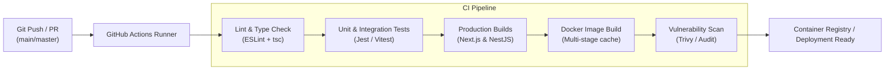
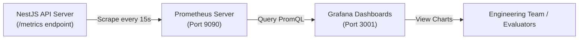

# MATCH@SAHRDAYA — CI/CD Pipeline, Monitoring & Error Tracking

> **Course Requirement & SKILL.md Standard:** Demonstrate a basic CI/CD workflow (GitHub Actions) and monitoring/logging/error tracking (Sentry, Prometheus, Grafana).  

> [!IMPORTANT]
> **SKILL.md Integrity Mandates:**
> - CI/CD must run real checks supported by the repo. A build/test workflow is continuous integration, not continuous deployment unless a deploy step explicitly deploys to an environment.
> - Never log secrets, passwords, or JWT tokens in logs or metrics.
> - Do not claim infrastructure or monitoring works without verifying it.

---

## 1. Continuous Integration & Delivery (CI/CD) Architecture



---

## 2. GitHub Actions CI Workflow (`.github/workflows/ci.yml`)

```yaml
name: MATCH@SAHRDAYA CI Pipeline

on:
  push:
    branches: [ master, main, develop ]
  pull_request:
    branches: [ master, main ]

concurrency:
  group: ${{ github.workflow }}-${{ github.ref }}
  cancel-in-progress: true

jobs:
  # ----------------------------------------------------------------------------
  # Job 1: Code Quality & Type Integrity
  # ----------------------------------------------------------------------------
  code-quality:
    name: Code Quality & Type Integrity
    runs-on: ubuntu-latest
    steps:
      - name: Checkout Code
        uses: actions/checkout@v4

      - name: Setup Node.js 20
        uses: actions/setup-node@v4
        with:
          node-version: 20
          cache: 'npm'

      - name: Install Dependencies
        run: npm ci

      - name: Run ESLint
        run: npm run lint

      - name: Verify TypeScript Compilation
        run: npm run type-check

  # ----------------------------------------------------------------------------
  # Job 2: Automated Testing
  # ----------------------------------------------------------------------------
  unit-tests:
    name: Automated Unit & Integration Tests
    needs: code-quality
    runs-on: ubuntu-latest
    steps:
      - name: Checkout Code
        uses: actions/checkout@v4

      - name: Setup Node.js 20
        uses: actions/setup-node@v4
        with:
          node-version: 20
          cache: 'npm'

      - name: Install Dependencies
        run: npm ci

      - name: Execute Tests with Coverage
        run: npm test -- --coverage --passWithNoTests

  # ----------------------------------------------------------------------------
  # Job 3: Production Build Verification
  # ----------------------------------------------------------------------------
  build-production:
    name: Production Build Verification
    needs: code-quality
    runs-on: ubuntu-latest
    env:
      NEXT_TELEMETRY_DISABLED: 1
      NODE_ENV: production
    steps:
      - name: Checkout Code
        uses: actions/checkout@v4

      - name: Setup Node.js 20
        uses: actions/setup-node@v4
        with:
          node-version: 20
          cache: 'npm'

      - name: Install Dependencies
        run: npm ci

      - name: Build Next.js Application
        run: npm run build

  # ----------------------------------------------------------------------------
  # Job 4: Container Build Verification
  # ----------------------------------------------------------------------------
  docker-build:
    name: Docker Containerization Build Check
    needs: [build-production, unit-tests]
    runs-on: ubuntu-latest
    steps:
      - name: Checkout Code
        uses: actions/checkout@v4

      - name: Set up Docker Buildx
        uses: docker/setup-buildx-action@v3

      - name: Build Next.js Frontend Image
        uses: docker/build-push-action@v5
        with:
          context: .
          push: false
          tags: match-sahrdaya-frontend:ci-test
          cache-from: type=gha
          cache-to: type=gha,mode=max
```

---

## 3. Error Tracking with Sentry

### 3.1 Next.js Frontend Configuration (`sentry.client.config.ts`)
```typescript
import * as Sentry from '@sentry/nextjs';

Sentry.init({
  dsn: process.env.NEXT_PUBLIC_SENTRY_DSN,
  tracesSampleRate: 1.0,
  replaysSessionSampleRate: 0.1,
  replaysOnErrorSampleRate: 1.0,
  integrations: [
    Sentry.replayIntegration({
      maskAllText: true,
      blockAllMedia: true,
    }),
  ],
  environment: process.env.NODE_ENV,
});
```

### 3.2 NestJS Backend Global Exception Filter (`sentry.filter.ts`)
```typescript
import { Catch, ArgumentsHost, HttpException, HttpStatus } from '@nestjs/common';
import { BaseExceptionFilter } from '@nestjs/core';
import * as Sentry from '@sentry/node';

@Catch()
export class SentryExceptionFilter extends BaseExceptionFilter {
  catch(exception: unknown, host: ArgumentsHost) {
    const status =
      exception instanceof HttpException
        ? exception.getStatus()
        : HttpStatus.INTERNAL_SERVER_ERROR;

    // Report server errors (5xx) to Sentry
    if (status >= 500) {
      Sentry.captureException(exception);
    }

    super.catch(exception, host);
  }
}
```

---

## 4. Metrics & Monitoring (Prometheus & Grafana)



### 4.1 Prometheus Metrics Exposed by NestJS
NestJS exports Prometheus metrics on `GET /metrics`:

| Metric Name | Type | Description |
|---|---|---|
| `http_requests_total` | Counter | Total HTTP requests categorized by route, method, and status code |
| `http_request_duration_seconds` | Histogram | Request latency distributions across API endpoints |
| `graphql_resolver_duration_seconds` | Histogram | Execution timing for individual queries and mutations |
| `cupid_matches_executed_total` | Counter | Total matchmaking actions triggered by students |
| `active_chat_connections` | Gauge | Count of active WebSocket chat subscriptions |
| `nodejs_heap_size_used_bytes` | Gauge | Node.js V8 memory utilization |

### 4.2 Prometheus Scrape Configuration (`prometheus.yml`)
```yaml
global:
  scrape_interval: 15s
  evaluation_interval: 15s

scrape_configs:
  - job_name: 'match-sahrdaya-backend'
    metrics_path: '/metrics'
    static_configs:
      - targets: ['backend-service:4000']
        labels:
          environment: 'production'
          app: 'match-at-sahrdaya'
```

### 4.3 Grafana Dashboard Panels

1. **System Health:**
   - Pod CPU & Memory Usage
   - HTTP 2xx vs 4xx vs 5xx throughput
2. **Business Metrics:**
   - Live Matching Rate (Matches created per hour)
   - Message Volume & Peak Chat Times
   - Active Users by College Year (1st, 2nd, 3rd, 4th year distribution)
3. **API Performance:**
   - p95 and p99 GraphQL Mutation Latencies
   - Database Connection Pool Availability
