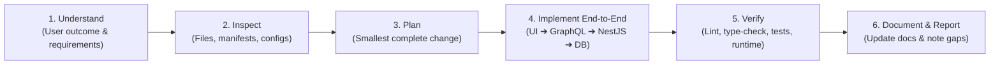
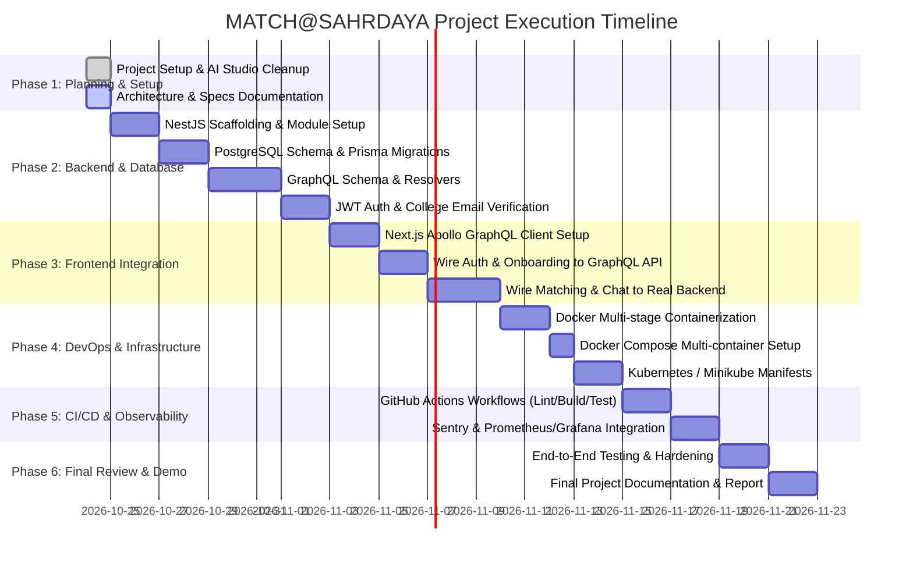

# MATCH@SAHRDAYA — Comprehensive Project Roadmap & Execution Plan

> **Operational Standard:** Engineered strictly in accordance with `SKILL.md` engineering principles, multi-layer integration requirements, and Web Technologies Project Guidelines.

---

## 1. Project Background & Problem Statement

### 1.1 Context
In large collegiate environments, students often find it challenging to connect with peers outside their immediate branch, year, or friend circles. Traditional dating and matchmaking platforms are broad, non-exclusive, lack campus safety guarantees, and are not tailored for college student culture and seasonal events (such as Valentine's season).

### 1.2 Proposed Solution: MATCH@SAHRDAYA
A verified, time-bounded, campus-exclusive social matching application that connects students using:
- **Verified college authentication** (`@sahrdaya.ac.in` domain identity validation).
- **Dual Matching Mechanisms:**
  1. *Cupid Matchmaking:* Multi-attribute weighted interest compatibility scoring.
  2. *Serendipity Matchmaking:* Random discovery for meeting unexpected peers.
- **Interactive Matching Experience:** A 10-second animated anticipation sequence with contextual campus picks.
- **Real-Time Communication:** Direct messaging between mutually matched students.
- **Safety & Moderation:** Granular blocking, reporting, and moderation controls to guarantee campus safety.

---

## 2. Technical Stack & Architectural Constraints

Per the course guidelines and `SKILL.md` engineering rules:

| Layer | Requirement | Implementation Choice | Justification |
|---|---|---|---|
| **Frontend** | Next.js with React & Modern CSS | Next.js 15 (App Router), React 19, Tailwind CSS v4, Motion (Framer Motion) | High performance SSR/CSR, fluid animations, campus-themed typography & styling. |
| **Backend** | NestJS | NestJS v10+ with TypeScript | Robust enterprise module architecture, dependency injection, and clean separation of concerns. |
| **API** | GraphQL | Apollo Server / NestJS `@nestjs/graphql` | Strongly typed operations, client-specific queries, zero over-fetching, live subscriptions. |
| **Data** | Relational / Cloud Database | PostgreSQL 16 with Prisma ORM | Relational integrity for user profiles, foreign key constraints for matches/messages, ACID transactions. |
| **Project Workflow** | Git/GitHub | Conventional Commits, Feature Branching | Standardized collaboration, clear commit history. |
| **Delivery** | Docker & Compose | Multi-stage Dockerfiles + Docker Compose | Isolated, reproducible development and production builds. |
| **CI/CD** | GitHub Actions | Automated linting, type-checking, building, container testing | Continuous quality gate before deployment. |
| **Orchestration** | Kubernetes / Minikube | Declarative Pods, Services, Ingress, PersistentVolumes | Local cluster verification and scalable delivery. |
| **Monitoring** | Error & Performance Observability | Sentry (Error Tracking) + Prometheus & Grafana (Metrics) | Real-time health monitoring and traffic observability. |

---

## 3. Mandatory SKILL.md Development Workflow

Every subsequent task executed on this repository must follow the standard 6-step workflow:

1. **Understand:** Identify the concrete user outcome and relevant functional requirements. Record material assumptions; do not invent requirements.
2. **Inspect:** Examine affected files, project structure, manifests, configuration, tests, and existing scripts before editing. Preserve working behavior and local conventions.
3. **Plan:** Choose the smallest complete change and identify affected layers, risks, and verification checks.
4. **Implement End to End:** Connect the UI, GraphQL API, NestJS services, and database wherever the workflow requires them. **Do not stop at a stub when real integration is expected.**
5. **Verify:** Run relevant existing lint, type-check, test, build, and/or runtime checks. Investigate failures rather than hiding them.
6. **Document and Report:** Update affected setup/API/deployment documentation. State what changed, checks actually run and their results, and any remaining gaps.

---

## 4. Phased Implementation Roadmap

---

### Detailed Milestone Breakdown

#### Phase 1: Repository Hygiene & Foundation (Completed)
- [x] Extract and document requirements from project guidelines.
- [x] Clean AI Studio boilerplate (`metadata.json`, HMR hooks, redundant ESLint configs).
- [x] Establish secure, multi-tier `.env.example`.
- [x] Configure `.gitignore` to prevent leaking agent instructions and internal PDFs.
- [x] Create comprehensive architecture document (`docs/ARCHITECTURE.md`).
- [x] Create detailed GraphQL API specification (`docs/GRAPHQL_API_SPEC.md`).
- [x] Create relational database schema design (`docs/DATABASE_SCHEMA.md`).
- [x] Create containerization and Kubernetes deployment guide (`docs/DOCKER_K8S_GUIDE.md`).
- [x] Create monitoring, error tracking, and CI/CD guide (`docs/MONITORING_CICD.md`).
- [x] Overhaul root `README.md` for professional portfolio standards.

#### Phase 2: NestJS Backend & Database Construction (Pending User Approval)
- [ ] Scaffold NestJS backend in designated directory (`backend/`).
- [ ] Configure Prisma with PostgreSQL database driver.
- [ ] Define User, Profile, Interest, Match, Conversation, Message, and Report entities.
- [ ] Implement database migrations and automated seeding for demo campus users.
- [ ] Implement JWT authentication module with email domain restriction (`@sahrdaya.ac.in`).
- [ ] Build GraphQL resolvers for Auth, Users, Matchmaking, and Chat.

#### Phase 3: Frontend Modernization & API Integration
- [ ] Replace `lib/storage.ts` localStorage mock state with Apollo Client queries & mutations.
- [ ] Convert client-side simulated matchmaking to invoke GraphQL mutation `findMatch`.
- [ ] Convert client-side simulated chat to real-time messaging backed by NestJS GraphQL mutations/subscriptions.
- [ ] Add loading skeletons, network error handling, and session persistence.
- [ ] Validate responsive layouts on mobile, tablet, and desktop viewports.

#### Phase 4: Containerization & Cloud Deployment
- [ ] Create production-ready, multi-stage `Dockerfile` for Next.js frontend (standalone output).
- [ ] Create production-ready, multi-stage `Dockerfile` for NestJS backend.
- [ ] Compose orchestration (`docker-compose.yml`) linking Frontend, Backend, PostgreSQL, and Redis.
- [ ] Develop Kubernetes manifests:
  - `k8s/frontend-deployment.yaml` and `k8s/frontend-service.yaml`
  - `k8s/backend-deployment.yaml` and `k8s/backend-service.yaml`
  - `k8s/postgres-statefulset.yaml` and `k8s/postgres-pvc.yaml`
  - `k8s/ingress.yaml`
- [ ] Validate cluster deployment locally on Minikube with health probes (`livenessProbe` / `readinessProbe`).

#### Phase 5: CI/CD & Observability
- [ ] Implement GitHub Actions workflow (`.github/workflows/ci.yml`):
  - Next.js type-check and linting.
  - NestJS compilation, unit tests, and e2e tests.
  - Docker container build verification.
- [ ] Configure Sentry for Next.js and NestJS error tracking.
- [ ] Configure Prometheus metrics exporter in NestJS and Grafana dashboard manifests.

#### Phase 6: Final Evaluation & Demonstration
- [ ] Prepare comprehensive demonstration script showing the full user journey:
  1. Student login via college credentials.
  2. Profile setup with interests and preferences.
  3. Cupid matching with animated wait screen.
  4. Real-time messaging between two active sessions.
  5. User blocking/reporting verification.
  6. Live container/pod status inspection in Minikube.
  7. Sentry error monitoring demonstration.
- [ ] Finalize technical submission report.

---

## 5. SKILL.md Definition of Done Checklist

A change or milestone is considered **Done** only when:

- [ ] **Next.js, NestJS, GraphQL, and Database Integrated:** Core workflows operate across the complete chain without mock data masquerading as backend logic.
- [ ] **Functional Integrity:** Core features, validation, error states, and server-side access controls work end-to-end.
- [ ] **Quality Checks Pass:** Linting, TypeScript checks, and test suites pass, or failures and untested areas are explicitly documented.
- [ ] **DevOps & Infrastructure Ready:** Git/GitHub, Docker, CI/CD, Kubernetes/Minikube, and basic logging/monitoring are configured and verified.
- [ ] **Documentation Matches Implementation:** Setup, API, and deployment instructions match the code accurately.
- [ ] **Truthfulness Guarantee:** Never fabricate features, test results, coverage, security claims, screenshots, integrations, or deployment status.
